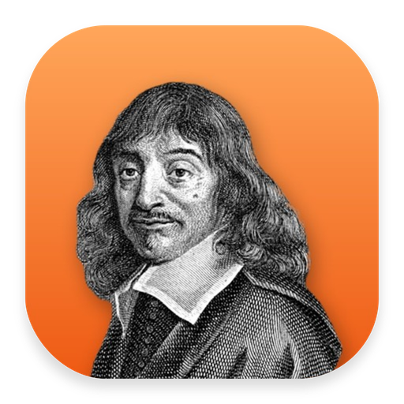
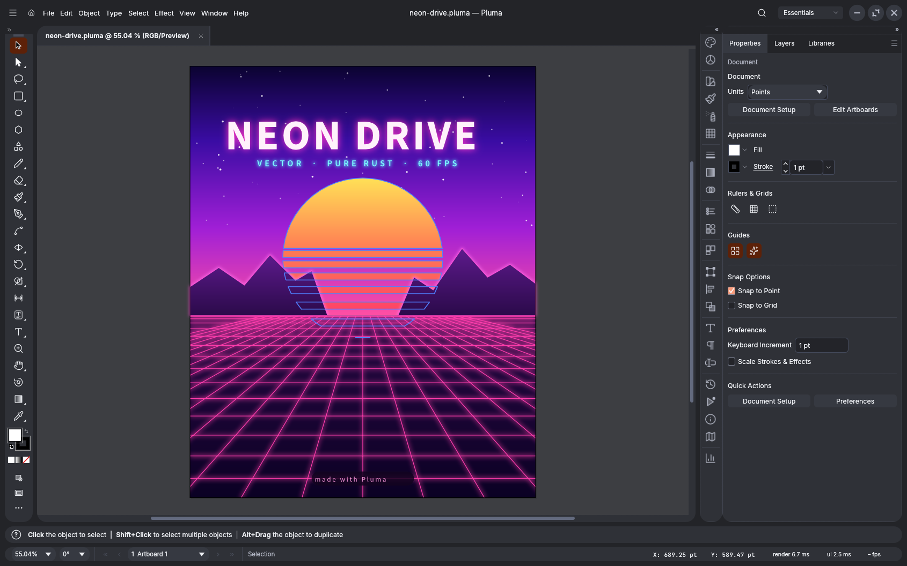
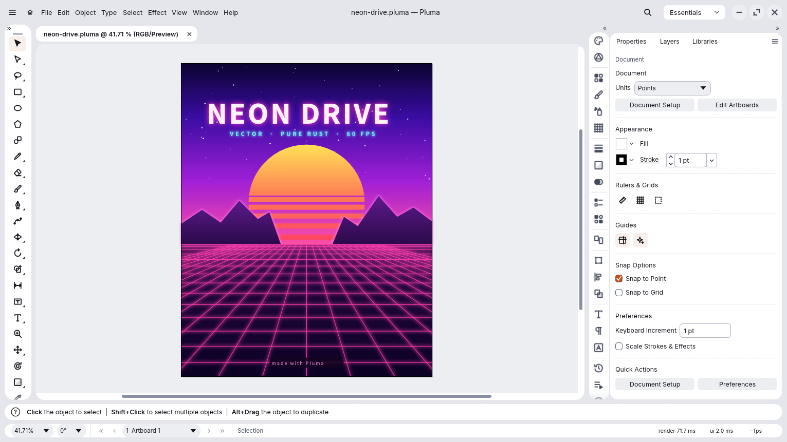
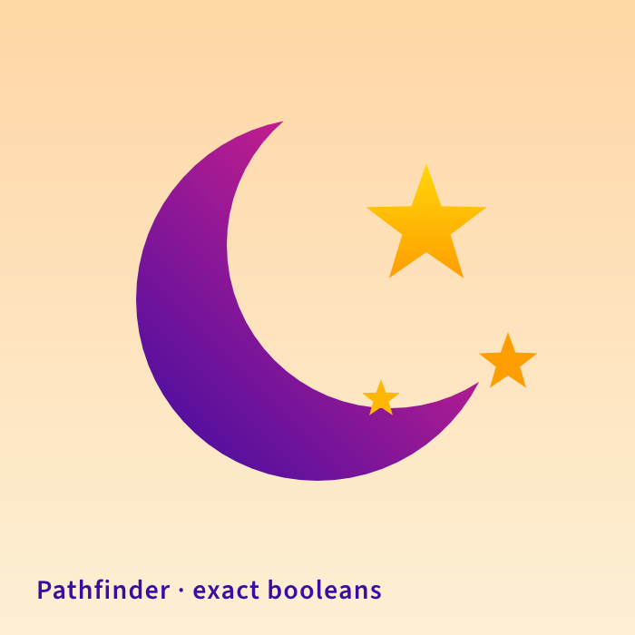
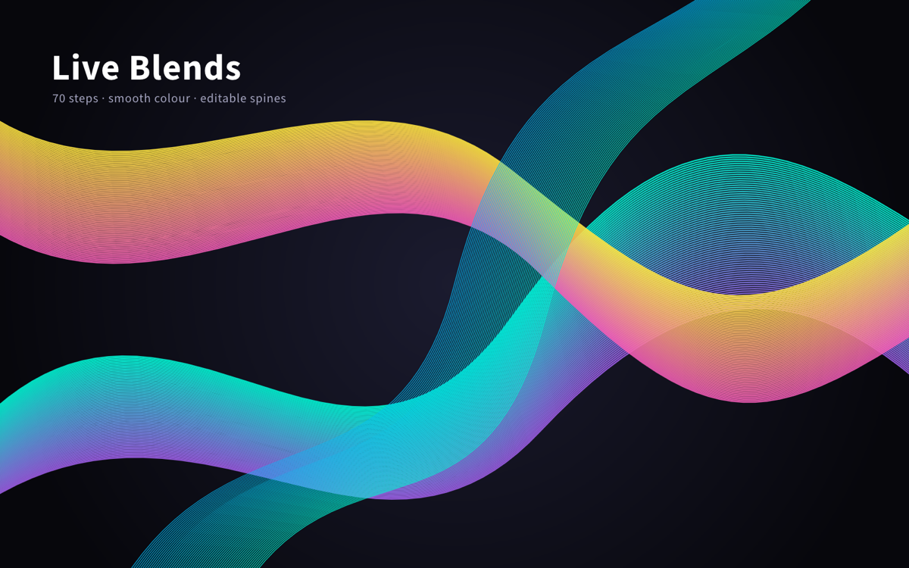
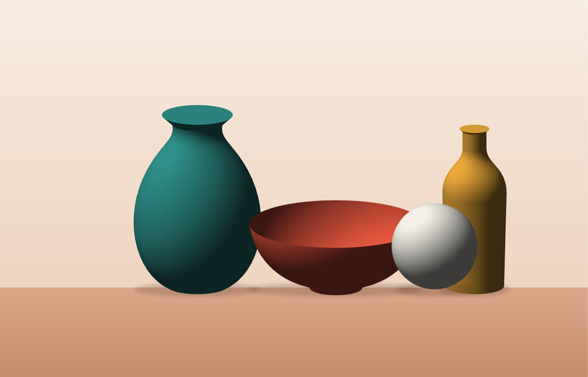

<div align="center">
  <a href="https://getnodalia.com">
    
  </a>
  <br><br>
  
  <h1>Pluma</h1>
  <p><strong>The vector illustration app of the Nodalia suite.</strong></p>

  <p>
    
    
    
  </p>

  <p>
    <a href="https://getnodalia.com/pluma">Website</a> ·
    <a href="#screenshots">Screenshots</a> ·
    <a href="#what-it-does">What it does</a> ·
    <a href="#download">Download</a> ·
    <a href="#build-and-run">Build</a> ·
    <a href="#agents-and-the-command-line">Agents</a> ·
    <a href="#license">License</a>
  </p>
</div>

<p align="center">
  
  <br><sub><b>Neon Drive</b> (<a href="examples/neon-drive.pluma">examples/neon-drive.pluma</a>): gradients, glows, type and a perspective grid, drawn and saved in Pluma.</sub>
</p>

---

## Overview

**Pluma** is the vector illustration app of [Nodalia](https://getnodalia.com): paths, shapes, type
and artboards for posters, logos, icons and technical drawings. It is a native app written in Rust,
with no account and no cloud, and it runs on Linux, macOS and Windows. It wears Nodalia Design:
rounded islands on the window colour, bold icons, and the suite's own window controls on Linux.

> [!IMPORTANT]
> **Pluma is at an early stage.** Expect rough edges, and keep a copy of documents that matter.

## Screenshots

<table>
  <tr>
    <td width="50%"></td>
    <td width="50%"></td>
  </tr>
  <tr>
    <td><sub><b>Light theme</b>: the same islands in light; the theme is chosen in Preferences.</sub></td>
    <td><sub><b>Pathfinder</b>: unite, subtract, intersect and divide shapes.</sub></td>
  </tr>
  <tr>
    <td></td>
    <td></td>
  </tr>
  <tr>
    <td><sub><b>Ribbons</b>: gradients along curved paths.</sub></td>
    <td><sub><b>Still life</b>: shapes, gradient meshes and shading.</sub></td>
  </tr>
</table>

## What it does

- **Drawing.** The pen, curvature and pencil tools, shapes, the shape builder, brushes and the
  eraser, with smart guides and snapping.
- **Type.** Point, area and path type with OpenType features, paragraph and character styles.
- **Colour and appearance.** Swatches, gradients and gradient meshes, multiple fills and strokes,
  effects, blend modes and opacity masks.
- **Structure.** Artboards, layers, groups, symbols, clipping masks and a perspective grid.
- **Files.** Its own `.pluma` documents, SVG, PDF, EPS and Affinity import, and export to SVG, PDF,
  PNG and more.
- **Updates from the app.** Pluma tells you when a new version is out and installs it for you.
- **Many languages.** English, Spanish and more, switched live.

The full, honest list of what works and what does not yet is in [ROADMAP.md](ROADMAP.md) and
[docs/gaps.md](docs/gaps.md).

## Download

Get the latest version from [getnodalia.com/pluma](https://getnodalia.com/pluma) or the
[releases page](https://github.com/getnodalia/pluma/releases/latest).

| System | File |
|---|---|
| macOS (Apple Silicon and Intel) | `pluma-<version>-macos-universal.dmg` |
| Windows x64 | `pluma-<version>-windows-x64.msi`, or the portable `.zip` |
| Linux x86_64 | `.AppImage`, `.deb` (Debian, Ubuntu), `.rpm` (Fedora, openSUSE) or `.tar.gz` |

The macOS DMG is not signed: the first time, right-click Pluma in Applications, choose **Open** and
confirm.

## Build and run

You need Rust 1.95 or later.

```bash
git clone https://github.com/getnodalia/pluma.git
cd pluma
cargo run --release -p pluma -- examples/neon-drive.pluma
```

## Agents and the command line

Every menu item and tool is a command, so scripts and agents can do anything a person can:

```bash
pluma-cli mcp                                      # MCP server on stdio
pluma-cli convert poster.pluma poster.pdf          # convert or export
pluma-cli run --cmd shape.rectangle --params '{"x":10,"y":10,"width":100,"height":50}' --export out.png
```

The desktop app also takes a JSON control channel (`--control PORT`). See [docs/mcp.md](docs/mcp.md).

## App icon

Nodalia app icons are black-and-white portraits of historical figures over the app colour.
Pluma's is René Descartes, who gave geometry its coordinates. Provenance and licence are in [`assets/app-icon/`](assets/app-icon/).

## The Nodalia suite

Pluma is one of the applications of [Nodalia](https://getnodalia.com), an independent software
project developed in public by [Daniel Miguel Tejedor](https://danielmigueltejedor.com).

## License

`MIT OR Apache-2.0`. See [`LICENSE-MIT`](LICENSE-MIT), [`LICENSE-APACHE`](LICENSE-APACHE) and
[`NOTICE`](NOTICE).
